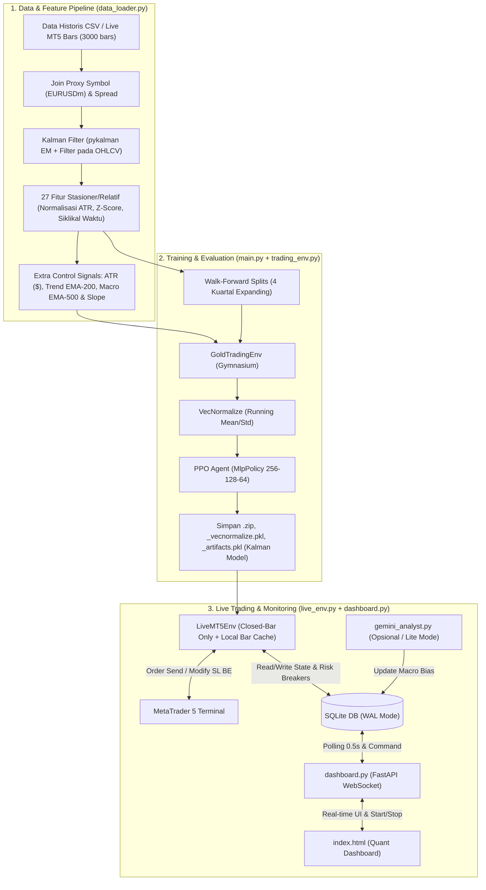

# Dokumentasi Arsitektur & Bedah File `RL_kalman` (XAUUSD RL Trading Bot)

Dokumen ini merangkum arsitektur menyeluruh, alur data (*pipeline*), mekanisme *Reinforcement Learning* (PPO + Kalman Filter), manajemen risiko, serta fungsi dari **setiap file** yang ada di dalam repositori `RL_kalman` (termasuk sub-direktori eksperimen `rl_kalman_mtf`).

---

## 1. Gambaran Umum Arsitektur Sistem

Bot ini adalah sistem perdagangan otomatis (*algorithmic trading*) untuk **XAUUSD (Gold)** di MetaTrader 5 (Exness, simbol `XAUUSDm` untuk demo/standar dan `XAUUSDc` untuk akun real/cent) yang menggabungkan:
1. **Denoising Sinyal (Kalman Filter)**: Menghaluskan *noise* mikrostruktur pasar pada data OHLCV (`open`, `high`, `low`, `close`, `tick_volume`) menggunakan *Expectation-Maximization (EM) Kalman Filter*.
2. **Rekayasa Fitur Stasioner/Relatif (`v4_relative` & `v5_raw`)**: Seluruh 27 fitur pasar dinormalisasi terhadap **ATR-14**, persentase deviasi, *rolling Z-score*, atau *bounded oscillators* (`[-1, 1]`), ditambah *clipping* `[-5, 5]` dan `VecNormalize` dari *Stable-Baselines3*. Hal ini mengatasi masalah *distribution shift* saat harga emas mencetak rekor baru (*all-time high*).
3. **Otak Taktis RL (Proximal Policy Optimization - PPO)**: Jaringan saraf tiruan (`MlpPolicy` dengan arsitektur terpisah `pi=[256, 128, 64]` dan `vf=[256, 128, 64]`) yang memetakan *state vector* berdimensi **28** (27 fitur pasar + 1 status posisi saat ini) ke **3 aksi diskrit**:
   - `0` $\rightarrow$ `-1.0` (**SELL / Short**)
   - `1` $\rightarrow$ `0.0` (**FLAT / Hold / Close**)
   - `2` $\rightarrow$ `+1.0` (**BUY / Long**)
4. **Manajemen Risiko & Guardrails Berlapis (Hard-coded di Environment)**:
   - **Dynamic ATR SL/TP** dengan *floor* (`MIN_SL_PTS`, `MIN_TP_PTS`) dan *ceiling* (`MAX_SL_PTS`).
   - **Auto Break-Even (BE)**: Menggeser SL ke `entry_price ± BE_BUFFER_PTS` ketika *Maximum Favorable Excursion* (MFE) mencapai `50%` dari jarak TP (`BE_TRIGGER_PCT = 0.50`).
   - **Anti-Overtrading**: `MIN_HOLD_STEPS` (wajib tahan posisi minimal 15 menit), `LOSS_COOLDOWN_STEPS` (jeda 10 menit setelah tutup rugi karena sinyal), dan `MAX_HOLD_LOSS_STEPS` (cut-loss paksa jika posisi minus tertahan > 600 menit).
   - **Circuit Breakers (Live)**: *Daily Loss Breaker* (5% per hari), *Cumulative Real SL Streak Breaker* (8x SL asli $\le -\$1$ memicu *cooldown* 120 menit), *Drawdown Kill Switch* (15% dari puncak saldo historis memaksa status `PAUSED`), dan *Explicit Weekend Protection* (tutup posisi H-30 menit sebelum penutupan pasar Jumat).
5. **Komunikasi Antar-Proses via SQLite (`WAL Mode`) & WebSocket Dashboard**:
   - `live_env.py` mencatat transaksi, log, status posisi, dan ekuitas ke database SQLite (`bot_database.db`), serta membaca tabel `bot_control` (`RUNNING` / `PAUSED`) dan `risk_state`.
   - `dashboard.py` (FastAPI + WebSocket) menyajikan antarmuka *real-time* (`index.html`) untuk memantau metrik dan menekan tombol **START / STOP** dari perangkat mobile/desktop.

---

## 2. Evolusi Versi Model di Dalam Proyek

Dari struktur file dan komentar kode, terlihat evolusi pengembangan bot melalui beberapa generasi penting:
1. **`ppo_v2_dynamic` (di folder `rl_kalman_mtf/`)**:
   - Menggunakan fitur level harga absolut (`close_kf`, `sma_5`, `bb_h`, dll.) yang rentan terhadap *distribution shift* saat XAUUSD naik ke harga baru.
   - Menggunakan arsitektur **Multi-Timeframe Dual-Brain**: "Jenderal M5" memberi sinyal arah (`m5_action`) yang disuntikkan ke observasi "Sniper M1", dengan *hard-block* jika M1 melawan M5 atau EMA-200.
2. **`ppo_v4_relative` (di folder `models/`)**:
   - Merombak seluruh fitur observasi menjadi **stasioner/relatif** terhadap ATR dan persentase (menghilangkan level harga mentah dari *observation space*).
   - Menyatukan konfigurasi multi-timeframe menggunakan `TIMEFRAME_PROFILES` (`1M` dan `5M`) di `config.py`.
   - Menyelaraskan perhitungan SL/TP/Lot dan lookback indikator antara *training* (`trading_env.py`) dan *live* (`live_env.py`).
3. **`ppo_v5_raw` (Konfigurasi Aktif Saat Ini di `config.py`)**:
   - Mengubah `EXECUTION_PRICE_SOURCE = "raw"` dan `SPREAD_COST_FRACTION = 0.5`.
   - **Alasan Kritis**: Temuan dari data *live* 2 minggu menunjukkan harga `close_kf` (Kalman) menyimpang rata-rata `$0.30` dan tertinggal `-$0.18` dari harga pasar riil. Sebelumnya simulator mengeksekusi transaksi pada harga `kalman` yang terlalu mulus (membuat *backtest* terlihat sangat profit padahal ilusi penghalusan harga) namun menagih biaya spread 2x lipat (`1.0` saat buka dan `1.0` saat tutup). Pada `v5_raw`, fitur input ke model **tetap memakai Kalman**, tetapi harga eksekusi, SL/TP, dan P&L di simulator menggunakan **harga `close` mentah (raw)** dengan biaya spread realistis (`0.5` per sisi = `1.0x` spread per *round-trip*).

---

## 3. Bedah Detail Setiap File di Direktori Utama (`RL_kalman/`)

### A. Modul Inti (*Core Architecture*)

#### 1. `config.py`
Pusat konfigurasi tunggal untuk menyamakan parameter antara *training*, *backtest*, dan *live*:
- **Simbol & Timeframe**: `DEFAULT_SYMBOL = "XAUUSDm"`, `PROXY_SYMBOL = "EURUSDm"` (diperbaiki dari sebelumnya `EURUSDc` yang membuat fitur korelasi EURUSD bernilai nol karena file tidak ditemukan), `DEFAULT_TIMEFRAME = "1M"`, `MODEL_PREFIX = "ppo_v5_raw"`.
- **Kalibrasi Broker**: `POINT = 0.001` (3 desimal di Exness XAUUSDm, di mana `1000 pts = $1.00` dan `1 pip = 100 pts = $0.10`).
- **Paritas Live-Train**:
  - `LIVE_LOOKBACK_BARS = 3000`: Menarik 3000 bar agar `EMA-500` (`MACRO_EMA_SPAN`) dan Kalman Filter sudah *converge* sempurna seperti saat training.
  - `LIVE_USE_CLOSED_BAR_ONLY = True`: Membuang bar terakhir yang masih bergerak (belum *close*) agar distribusi fitur live identik dengan data training.
- **Manajemen Risiko & SL/TP Dinamis (Basis M1)**:
  - `INITIAL_BALANCE = 1000.0`, `RISK_PER_TRADE = 10.0` ($10 per trade), `MAX_SIZE_OZ = 100.0` (1.00 lot).
  - `SL_ATR_MULTIPLIER = 2.0`, `TP_ATR_MULTIPLIER = 4.0` (Risk:Reward = 1:2).
  - Batas M1: `MIN_SL_PTS = 3600` ($3.6), `MAX_SL_PTS = 9000` ($9.0), `MIN_TP_PTS = 7200` ($7.2).
  - Break-Even: `BE_TRIGGER_PCT = 0.50` (aktif saat profit mencapai 50% target TP), `BE_BUFFER_PTS = 200` ($0.20 di atas/bawah entry).
- **Filter & Anti-Churning (Basis M1)**:
  - `ENABLE_WEEKEND_FIREWALL = True` (Jumat $\ge 04:00$ s/d Senin $< 05:00$ waktu server), `WEEKEND_CLOSE_BUFFER_MINUTES = 30`.
  - `ENABLE_TOXIC_HOUR_FILTER = False` (daftar `TOXIC_HOURS = [4, 5, 7, 11, 17]`).
  - `ENABLE_TREND_FILTER = True`, `TREND_FILTER_HARD_BLOCK = False`, `TREND_FILTER_PENALTY = 0.3` (*soft guidance*: memberi penalti reward jika melawan `EMA-200` atau `macro_slope`, bukan memblokir paksa).
  - `MIN_HOLD_STEPS = 15`, `LOSS_COOLDOWN_STEPS = 10`, `MAX_HOLD_LOSS_STEPS = 600`, `CHURN_PENALTY = 2.0`, `IDLE_PENALTY_AFTER_STEPS = 20`.
- **Biaya Simulator Jujur**:
  - `EXECUTION_PRICE_SOURCE = "raw"`, `SPREAD_COST_FRACTION = 0.5`, `SLIPPAGE_PTS = 20.0` ($0.02/oz per transaksi), `COMMISSION_RATE = 0.0`.
- **Circuit Breakers (Live)**:
  - `ENABLE_KILL_SWITCH = True` (`KILL_SWITCH_DRAWDOWN_PCT = 0.15` / 15% dari saldo puncak).
  - `ENABLE_DAILY_LOSS_BREAKER = True` (`DAILY_LOSS_LIMIT_PCT = 0.05` / 5% dari saldo awal hari).
  - `ENABLE_STREAK_BREAKER = True` (`STREAK_SL_LIMIT = 8`, `STREAK_LOSS_MIN_USD = 1.0`, `STREAK_COOLDOWN_MINUTES = 120`).
- **Hyperparameter PPO & Reward**:
  - `GAMMA = 0.999`, `TOTAL_TIMESTEPS = 6_000_000` (M1) / `3_000_000` (M5), `EPISODE_LENGTH = 6000` (M1, ~4.2 hari) / `1200` (M5).
  - `REWARD_SCALE = 1000.0`, `REWARD_COEFFS_BY_TIMEFRAME` (`alpha`, `beta`, `gamma`, `delta`).
  - Fungsi `apply_timeframe_profile(timeframe)`: Menimpa variabel global secara dinamis berdasarkan argumen `--timeframe` (`1M` atau `5M`) dan selalu me-reset ke `_BASE_VALUES` terlebih dahulu agar tidak terjadi kebocoran state antar-run.

#### 2. `data_loader.py`
Bertugas memuat CSV, menggabungkan simbol proxy (`EURUSDm`), menjalankan Kalman Filter, dan membentuk matriks 27 fitur stasioner:
- `load_csv()`: Membaca `{symbol}_{timeframe}.csv`, menghitung `spread_price = spread * config.POINT`, melakukan *left join* dengan `{proxy_symbol}_{timeframe}.csv` (`proxy_close`, `proxy_tick_volume`), dan memotong baris awal jika data proxy belum mulai (`first_valid`).
- `apply_kalman_filter()`: Menggunakan `pykalman.KalmanFilter` (matriks transisi & observasi identitas $5\times 5$ pada `open, high, low, close, tick_volume`). Jika `model=None` (saat pretrain), melakukan *fitting* EM (`n_iter=15`) pada *subsample* 50.000 baris pertama, lalu mem-filter seluruh deret data menghasilkan kolom `*_kf`.
- `add_technical_indicators()`: Menghitung **27 fitur stasioner/relatif** dari harga `*_kf`:
  1. **Return & Bentuk Candle (5 fitur)**: `log_ret`, `candle_body_norm`, `candle_range_norm`, `upper_wick_norm`, `lower_wick_norm` (dinormalisasi terhadap `atr`).
  2. **Jarak Moving Average (6 fitur)**: `sma_5_dist`, `sma_10_dist`, `sma_20_dist`, `ema_9_dist`, `ema_21_dist`, dan `ema_cross_norm` (semua dibagi `atr`).
  3. **Bounded Oscillators (5 fitur)**: `rsi_norm` ($\in [-1, 1]$), `stoch_k_norm`, `stoch_d_norm`, `cci_norm` (dibagi 200, clip `[-3, 3]`), `williams_r_norm`.
  4. **Bollinger Bands & VWAP (3 fitur)**: `bb_pos` (posisi relatif dalam band), `bb_width_norm` (lebar band dibagi ATR), `vwap_dist`.
  5. **Tren Makro EMA-500 (2 fitur)**: `macro_dev_pct` (% jarak harga ke EMA-500) dan `macro_slope` (% perubahan 10-bar EMA-500).
  6. **Volume & Korelasi Proxy EURUSD (3 fitur)**: `volume_zscore` (rolling 50-bar Z-score), `proxy_ret`, `proxy_vol_zscore`.
  7. **Waktu Siklikal (4 fitur)**: `hour_sin`, `hour_cos`, `dow_sin`, `dow_cos` (agar agen mengenali karakter sesi Asia/London/NY dan jam likuiditas buruk secara alami).
- `build_feature_matrix()`: Memotong outlier fitur di `[-5.0, 5.0]` (`FEATURE_CLIP`), memilih `close_prices` (`raw` vs `kalman` sesuai `EXECUTION_PRICE_SOURCE`), dan mengembalikan dictionary `extra` (`macro_ema`, `macro_slope`, `trend_ema` EMA-200, dan `atr` dalam dolar) agar `trading_env.py` dan `live_env.py` memakai sinyal kontrol yang 100% identik.
- `walk_forward_splits()`: Membagi data menjadi 4 bagian dan membuat **3 siklus Walk-Forward Expanding**:
  - Split 1: Train Kuartal `[0..1]`, Test Kuartal `[1..2]`
  - Split 2: Train Kuartal `[0..2]`, Test Kuartal `[2..3]`
  - Split 3: Train Kuartal `[0..3]`, Test Kuartal `[3..4]`

#### 3. `kalman_filter.py` & `indicators.py`
- **`kalman_filter.py`**: Implementasi *standalone* Kalman Filter 1D/Multivariate (`MultivariateKalmanOHLCV`) berbasis *Expectation-Maximization* (EM) dan *steady-state Kalman gain* menggunakan `scipy.signal.lfilter` (IIR filter orde-1 kausal tanpa *look-ahead* dengan kompleksitas $O(n)$).
- **`indicators.py`**: Implementasi vektorisasi numpy/pandas murni untuk 17 indikator teknikal standar (menggunakan `sliding_window_view` untuk mempercepat perhitungan MAD pada CCI).
- *Catatan Arsitektur*: Saat ini `data_loader.py` menggunakan pustaka `pykalman` dan `ta` secara langsung, sehingga `kalman_filter.py` dan `indicators.py` berfungsi sebagai modul referensi/alternatif sesuai paper asli yang menjadi landasan proyek ini.

#### 4. `trading_env.py`
Lingkungan simulasi Gymnasium (`GoldTradingEnv`) untuk *training* dan *backtest*:
- **State Space**: `Box(low=-10.0, high=10.0, shape=(28,), dtype=float32)` (27 fitur + 1 posisi aktif `{-1, 0, 1}`).
- **Action Space**: `Discrete(3)` $\rightarrow$ `{0: -1.0 (SELL), 1: 0.0 (FLAT), 2: 1.0 (BUY)}`.
- **Determinisme Evaluasi (`eval_seed`)**: Menggunakan generator `np.random.default_rng(eval_seed)` terpisah agar ketika menjalankan `main.py backtest` berulang kali (misal menguji sensitivitas slippage), 10 episode yang di-sampling memiliki `start_idx` yang **selalu sama persis** (*apple-to-apple comparison*).
- **Mekanika `step(action)`**:
  1. Memeriksa proteksi akhir pekan (`ENABLE_WEEKEND_FIREWALL`) dan jam toksik (`ENABLE_TOXIC_HOUR_FILTER`). Jika aktif, memaksa `target_position = 0.0` (`forced_close = True`).
  2. Memeriksa `cooldown_timer` (setelah tutup rugi) dan `MIN_HOLD_STEPS` (mencegah tutup/balik arah sebelum 15 menit kecuali `forced_close`).
  3. Memeriksa `ENABLE_TREND_FILTER` (terhadap `trend_ema` EMA-200 dan `macro_slope`). Memberikan penalti `-TREND_FILTER_PENALTY` (`-0.3`) jika melawan tren.
  4. Menghitung jarak SL & TP dinamis dari `volatility` (ATR) yang di-clamp antara `[min_sl_dollars, max_sl_dollars]`.
  5. Melacak `mfe_price` selama posisi terbuka:
     - Jika `mfe_pts >= current_tp_dollars` $\rightarrow$ `forced_close = True` (Take Profit).
     - Jika `mfe_pts >= dynamic_be_trigger` (`50% TP`) $\rightarrow$ mengaktifkan Break-Even (`dynamic_sl_price = entry_price ± dynamic_be_buffer`).
     - Jika harga menyentuh `dynamic_sl_price` atau durasi posisi rugi melewati `MAX_HOLD_LOSS_STEPS` $\rightarrow$ `forced_close = True` (Stop Loss / Time Stop).
  6. **Kalkulasi Ukuran Posisi & Biaya Transaksi**:
     - `size_oz = min(RISK_PER_TRADE / current_sl_dollars, MAX_SIZE_OZ)`
     - `spread_cost = transacted_size * spread * SPREAD_COST_FRACTION`
     - `impact (slippage) = transacted_size * (SLIPPAGE_PTS * POINT)` (diperbaiki menjadi berbasis per-oz, bukan % dari nilai nosional).
  7. **Fungsi Reward Multi-Komponen**:
     - **Realized PnL Reward** (saat tutup posisi): $\pm (\text{PnL} / \text{balance}) \times \text{REWARD\_SCALE} \times \alpha$
     - **Unrealized Portfolio Return** (setiap step): $\text{portfolio\_return} \times \text{REWARD\_SCALE} \times \alpha$
     - **Transaction Cost Penalty** (saat ganti posisi): $-(\text{transaction\_cost} / \text{balance}) \times \text{REWARD\_SCALE} \times \alpha$
     - **Holding Shaping** (saat mempertahankan posisi terbuka): $+0.2$ jika floating profit $> 0$, atau $-0.1$ jika floating loss $\le 0$.
     - **Churn Penalty** (balik arah langsung Long $\leftrightarrow$ Short): $-\text{CHURN\_PENALTY} \times \gamma$.
     - **Drawdown Penalty** (setiap step): $-\text{drawdown} \times \text{REWARD\_SCALE} \times \beta \times 0.01$.
     - **Idle Penalty** (diam flat melebihi `IDLE_PENALTY_AFTER_STEPS` saat tidak sedang cooldown): $-\delta$.
     - **Margin Call Penalty**: Jika `drawdown >= 99%`, episode dihentikan (`terminated = True`) dengan penalti $-5000$.

#### 5. `main.py`
*Entry point* CLI utama dengan 3 sub-command (`pretrain`, `backtest`, `live`):
- Selalu memanggil `config.apply_timeframe_profile(args.timeframe)` di awal eksekusi agar parameter `1M` atau `5M` sinkron.
- **`pretrain`**:
  - Melakukan pelatihan *Walk-Forward* 3 tahap pada 4 split data menggunakan algoritma **PPO** (`DummyVecEnv` + `VecNormalize`).
  - Mendukung flag `--resume` untuk *continuous learning* dari bobot model dan statistik `VecNormalize` sebelumnya.
  - Menyimpan *checkpoint* berkala (`CheckpointCallback`), menggambar grafik kurva pembelajaran 6-panel (`TradingCallback` $\rightarrow$ `{prefix}_{tf}_learning_curve.png`), menyimpan `model.zip`, `_vecnormalize.pkl`, dan `_artifacts.pkl` (berisi `kalman_model` yang sudah di-fit, nama fitur, dan data test).
  - Di akhir tiap siklus Walk-Forward, menguji model selama 10 episode pada *unseen test split* dan mencatat hasilnya ke tabel `model_evaluations` di `bot_database.db` serta menyimpan grafik laporan `PRETRAIN_Report_*.png`.
- **`backtest`**:
  - Memuat model `.zip`, `_vecnormalize.pkl` (dengan `training=False, norm_reward=False`), dan `kalman_model` dari `_artifacts.pkl`.
  - Mengevaluasi model pada split terakhir (`test`) atau seluruh data (`all`) menggunakan `eval_seed` tetap (default `42`), menyimpan grafik ke `BACKTEST_Report_*.png` dan mencatat ke SQLite.
- **`live`**:
  - Menginisialisasi koneksi ke terminal MT5 yang sedang aktif (`mt5.initialize()`), memvalidasi simbol (`XAUUSDm` / `XAUUSDc`) dan simbol proxy (`EURUSDm`).
  - Memuat `LiveMT5Env` yang dibungkus dengan `DummyVecEnv` dan `VecNormalize` hasil training.
  -Mendukung flag `--db` dan `--magic` (memungkinkan beberapa bot, misal M1 dan M5, berjalan simultan di akun MT5 yang sama dengan database dan Magic Number berbeda) serta `--autostart`.
  - Menjalankan *infinite loop* `model.predict(obs, deterministic=True)` $\rightarrow$ `env.step(action)`.

#### 6. `live_env.py`
Lingkungan *live execution* (`LiveMT5Env`) yang menjembatani agen PPO dengan terminal MetaTrader 5 dan database SQLite:
- **Skema Database SQLite (`WAL Mode`)**:
  - `trade_details`: Mencatat detail lengkap setiap posisi dari buka hingga tutup (ticket, lot, entry/exit price, SL/TP, ATR volatility, bid/ask/spread, jam & hari server, profit, komisi, swap, `net_profit`, `mfe_usd`, `mae_usd`, `exit_reason`, `status`).
  - `ai_decisions`: Mencatat setiap keputusan bar demi bar beserta vektor `observation` (JSON).
  - `current_state`: Menyimpan baris tunggal (`id=1`) berisi saldo, profit harian, teks posisi aktif, bid, dan ask untuk dashboard.
  - `bot_logs`: Menyimpan log aktivitas (`INFO`, `BUY`, `SELL`, `CLOSE`, `WARNING`, `ERROR`).
  - `daily_profit`: Mencatat `start_balance` per tanggal kalender.
  - `gemini_bias`: Menyimpan bias makro/sentimen untuk ditampilkan di UI.
  - `bot_control`: Menyimpan status kontrol manual (`RUNNING` / `PAUSED`).
  - `risk_state`: Menyimpan state *circuit breaker* otomatis (`consecutive_real_sl`, `streak_paused_until`, `daily_breaker_date`).
- **Optimasi Latensi (`_fetch_bars_cached`)**:
  - Hanya menarik 3000 bar penuh sekali di awal untuk `XAUUSDm` dan `EURUSDm`. Pada langkah-langkah berikutnya hanya menarik 20 bar terbaru (`_FETCH_NEW_BARS = 20`) lalu menggabungkannya ke buffer memori lokal.
- **Siklus Eksekusi `step(action)`**:
  1. Sinkronisasi posisi aktif di MT5 berdasarkan `magic` number.
  2. Mengambil observasi terbaru dari **candle yang sudah tutup** (`df.iloc[:-1]`) sambil mengambil waktu server dari candle berjalan.
  3. Memeriksa **Kill Switch Drawdown** (15% dari puncak `daily_profit`), **Daily Loss Breaker** (5% rugi harian; mendukung mode per-akun atau `DAILY_BREAKER_PER_BOT`), **Streak Breaker** (8x SL asli kumulatif), **Proteksi Weekend Eksplisit** (menutup posisi otomatis 30 menit sebelum pasar tutup di hari Jumat), **Min Hold Steps**, **Loss Cooldown**, dan **Max Hold Loss Steps**.
  4. Jika terjadi perubahan sinyal (`target_position != self.position`), menutup posisi lama (`close_bot_positions`) dan/atau membuka posisi baru (`open_position`) dengan perhitungan SL, TP, dan ukuran lot (`risk_usd / current_sl_dollars`, otomatis *compounding* setiap kelipatan saldo \$1.000) yang **identik dengan `trading_env.py`**.
  5. **Intra-Candle Polling Loop (setiap 0.2 detik)**: Selama menunggu candle berikutnya tutup, bot terus memantau harga *tick* live untuk:
     - Melacak MFE & MAE dalam satuan USD.
     - Menggeser SL ke **Break-Even (`modify_sl`)** secara *real-time* begitu jarak profit menyentuh `50%` TP.
     - Mendeteksi jika posisi tertutup oleh broker (kena SL atau TP), mencatat histori deal dari `mt5.history_deals_get`, dan memperbarui penghitung `consecutive_real_sl` (SL di Break-Even diabaikan, SL rugi asli $\le -\$1$ menambah counter, TP asli me-reset counter ke 0).

---

### B. Antarmuka Web & Analis Eksternal

#### 7. `dashboard.py` & `index.html`
- **`dashboard.py`**: Server **FastAPI + Uvicorn** asinkron yang menyajikan `index.html` di endpoint `/` dan mengalirkan data *real-time* setiap `0.5 detik` melalui WebSocket `/ws` (status bot, saldo, profit hari ini, posisi & level Entry/SL/TP, log terminal terbaru, statistik 50 transaksi terakhir, serta menerima perintah `start_bot` / `stop_bot`). Mendukung kustomisasi `--port`, `--db`, `--symbol`, `--mode`, dan `--currency` (misal `$` atau `USC`).
- **`index.html`**: Antarmuka web responsif (*mobile-first dark UI*) dengan indikator status koneksi WebSocket (auto-reconnect), tombol kontrol **START / STOP** (dengan konfirmasi keamanan jika di mode `REAL`), kartu metrik ekuitas, serta 3 panel tab (*Terminal Eksekusi*, *Trade Tertutup Terbaru*, dan *Status AI*).

#### 8. `gemini_analyst.py` & `live_train.py`
- **`gemini_analyst.py`**: Skrip proses latar belakang (*background worker*) yang menarik 24 candle `H1` terakhir dari MT5 setiap 90 menit (`5400 detik`), mengirim 5 jam terakhir data OHLC ke model **Gemini (`google-genai`)** untuk menentukan bias struktur pasar makro (`BULLISH`, `BEARISH`, atau `SIDEWAYS`), lalu menyimpannya ke tabel `gemini_bias` di SQLite. *(Catatan: Di `live_env.py` terbaru saat ini telah diaktifkan "VPS Lite Mode" yang menonaktifkan FinBERT/Gemini secara default untuk menghemat RAM VPS).*
- **`live_train.py`**: Skrip eksperimen *Live On-Policy Fine-Tuning* generasi awal (`ppo_kalman_*`) yang menjalankan `gemini_analyst.py` sebagai sub-proses dan memanggil `model.learn()` langsung di atas `LiveMT5Env`. Saat ini eksekusi produksi utama sudah beralih ke `python main.py live` (mode inferensi murni dengan `learning_rate=0.0`).

---

### C. Peralatan Riset, Diagnostik & Evaluasi Kuantitatif

#### 9. `edge_scan.py`
Alat riset statistik **Fase 1 (Detektor Edge Murni sebelum RL & tanpa Kalman)**:
- Menguji apakah fitur-fitur kausal dari harga mentah (`ret`, `zscore`, `rsi14`, `stoch14`, `emadist`, `emaslope50`, `rangepos60`, `volsigned`, `rangeexp_signed`, `dayopen_dist`, `eur_ret`, `drift`) memiliki daya prediksi *out-of-sample* terhadap return masa depan setelah dikurangi biaya transaksi (`1x spread + 2x slippage`).
- Menggunakan **Expanding Walk-Forward** dengan embargo sepanjang horizon prediksi, dievaluasi pada berbagai rezim jam sesi (`S0..S3`) dan rezim volatilitas ATR (`V0..V2`).
- Menerapkan uji statistik ketat: *t-statistic* berbasis **Batch-Means** (mencegah *t-stat inflation* akibat return yang tumpang tindih), koreksi *multiple-testing* **Benjamini-Hochberg (FDR 5%)**, dan mekanisme **Holdout Data Lock** (mengunci 90 hari terakhir dan hanya mengizinkan pembukaan 1 kali dengan koreksi Bonferroni via `--confirm ... --unlock-holdout`).

#### 10. `random_baseline.py`
Benchmark kebijakan acak (*Random Policy*: pilih BUY/SELL/FLAT secara seragam dengan seed tetap) di dalam simulator `GoldTradingEnv` pada dua mode harga eksekusi (`kalman` vs `raw`). Digunakan untuk mengukur berapa besar kerugian yang murni disebabkan oleh biaya transaksi/mekanik simulator dan memastikan model RL benar-benar memiliki *skill* di atas tebakan acak.

#### 11. `check_market_params.py`
Skrip kalibrasi berbasis data untuk menghitung distribusi persentil (`p10`, `p25`, `median`, `p75`, `p90`, `p95`) dari ATR mentah, `raw_SL`, dan `raw_TP`, serta profil rata-rata spread per jam server. Memberikan rekomendasi otomatis nilai `MIN_SL_PTS` (dari persentil ke-25), `MAX_SL_PTS` (persentil ke-90), `MIN_TP_PTS`, dan kandidat `TOXIC_HOURS` (jam dengan spread $\ge 1.3\times$ rata-rata).

#### 12. `backtest_advanced.py`
Generator laporan analitik mendalam (*6-Panel Advanced Dashboard* & *Daily Performance Chart* dalam zona waktu WITA / UTC+8). Menghitung metrik institusional seperti *Profit Factor*, *Max Drawdown Duration*, *Trade Duration* (Win vs Loss), *Trade Efficiency* ($\text{MFE} / (\text{MFE} + \text{MAE})$), distribusi MFE dalam kelipatan $R$ (`0.25R` s/d `1.0R`), persentase transaksi rugi yang sempat profit (*loss but green*), serta breakdown profit per jam dan per hari.

#### 13. `analyze_db.py`
Skrip audit performa *live/demo* dari file database SQLite (misal `db2_m5.db` atau `bot_database.db`). Membaca seluruh transaksi berstatus `CLOSED` dari tabel `trade_details`, menghitung *Equity Curve*, *Drawdown (%)*, *Win Rate* harian & per jam server, serta menampilkannya dalam grafik 4 panel.

#### 14. `download_data.py`
Pengunduh data historis MT5 kapasitas besar (>100.000 bar) menggunakan teknik *chunking/pagination* (`50.000` bar per panggilan `mt5.copy_rates_from_pos`) untuk melewati batas limit satu kali panggil di terminal MT5. Menyimpan data ke `data/{SYMBOL}_{TIMEFRAME}.csv`.

#### 15. Skrip Diagnostik Tambahan
- **`diagnose_data_range.py`**: Melacak di tahap mana (`raw CSV` $\rightarrow$ `load_csv` $\rightarrow$ `build_feature_matrix` $\rightarrow$ `walk_forward_splits`) rentang tanggal data terpotong atau terdapat *gap* waktu besar.
- **`diagnose_episode_sampling.py`**: Memverifikasi bahwa penarikan indeks awal episode (`start_idx`) pada `GoldTradingEnv.reset()` dengan `eval_seed` tersebar merata dan deterministik di sepanjang *test split*.
- **`inspect_reward_scale.py`**: Membandingkan skala empiris `mean |return|` per bar dengan koefisien reward (`alpha`, `beta`, `gamma`, `delta`) untuk mencegah *reward hacking* (misal agen memilih diam selamanya jika penalti/bonus tidak seimbang dengan return rata-rata per bar).
- **`check_models.py`**: Utilitas singkat untuk mengecek daftar model Gemini yang tersedia melalui `google-genai` SDK.

---

## 4. Sub-Direktori `rl_kalman_mtf/` (Arsitektur Multi-Timeframe Dual-Brain)

Folder `RL_kalman/rl_kalman_mtf/` berisi implementasi cabang **MTF Dual-Brain (`ppo_v2_dynamic`)** dengan cara kerja:
1. **Pelatihan Jenderal M5**: Model PPO dilatih terlebih dahulu pada timeframe `5M`.
2. **Injeksi Sinyal Tanpa Lookahead Bias (`generate_mtf_dataset.py`)**:
   - Menjalankan inferensi model M5 di sepanjang histori `5M`.
   - Setiap sinyal M5 pada timestamp $t$ diberi cap `valid_time = t + 5 menit` (setelah candle M5 benar-benar tutup) lalu digabungkan ke dataset `1M` menggunakan `pd.merge_asof(..., direction='backward')` menghasilkan `XAUUSDm_1M_MTF.csv` dengan kolom tambahan `m5_action`.
3. **Pelatihan & Eksekusi Sniper M1 (`trading_env.py` & `live_env.py` di `rl_kalman_mtf/`)**:
   - Agen M1 membaca `m5_action` sebagai fitur observasi terakhir, dan di dalam `trading_env.py` terdapat aturan **Veto Jenderal M5**: M1 hanya diizinkan BUY jika `m5_action == 1.0` dan hanya diizinkan SELL jika `m5_action == -1.0`.
   - `visual_backtest.py` menyediakan laporan visual khusus MTF yang memisahkan status transaksi menjadi `WIN`, `LOSE`, dan `BREAK EVEN (BE)` (profit antara `-$2.00` s/d `+$2.50`).

---

## 5. Temuan Penting & Catatan Validasi untuk Pengembangan Selanjutnya

Sebagai bahan validasi sebelum kita mulai mengembangkan bot ini lebih lanjut, berikut adalah beberapa catatan teknis dari hasil bedah kode:
1. **Konsistensi Simulator (`v5_raw`)**: Kode di direktori utama (`RL_kalman/`) sudah sangat matang dalam memperbaiki *bias optimisme simulator* (memindahkan eksekusi ke harga `raw`, memperbaiki `PROXY_SYMBOL = "EURUSDm"`, menormalisasi fitur secara relatif terhadap ATR, dan menyamakan rumus SL/TP/ATR antara `trading_env.py` dan `live_env.py`).
2. **Inkompatibilitas Minor pada Skrip Lama**:
   - `backtest_advanced.py` baris 161 masih memanggil `config.SL_PRICE_DIST` (variabel dari config generasi lama yang sudah digantikan oleh `MIN_SL_PTS * POINT` di `config.py` terbaru), serta memanggil `GoldTradingEnv` tanpa membungkusnya dengan `VecNormalize` yang sesuai.
   - `live_env.py` baris 774 masih menggunakan konstanta `5000.0` untuk `step_reward` (hanya berdampak jika digunakan bersama `live_train.py`, tidak berdampak pada `main.py live` yang hanya memakai `predict()`).
3. **Keamanan Kredensial**: Terdapat API Key yang tertulis langsung (*hardcoded*) di dalam `gemini_analyst.py` dan `check_models.py`, serta file teks kredensial di root folder. Sebaiknya nantinya dipindahkan ke variabel lingkungan (`.env`) dan dimasukkan ke `.gitignore`.

